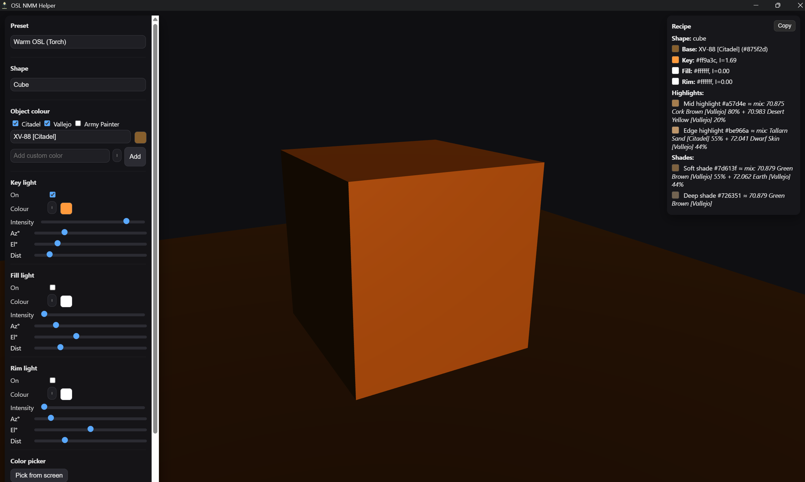

# 🌌 OSL & NMM Helper  

*Turn your desk lamp into a sun, and your paints into magic.*  

Miniature painting is all about light. Getting **Non-Metallic Metal (NMM)** highlights or glowing **Object Source Lighting (OSL)** right can make a model look like it stepped out of a cinematic still — but figuring out how light behaves can be a headache.  

That’s where **OSL & NMM Helper** comes in. This desktop app lets you experiment with light in real time, generate highlight/shadow transitions, and instantly translate them into **paint recipes using Citadel, Vallejo, or Army Painter paints.**  

Think of it as your digital lighting rig and recipe book, built for hobbyists who want pro-level results.  

---

## 📥 Downloads  

Get the latest release for your system:  

- 🪟 **Windows (.msi)** → [Download](https://github.com/mat2m10/osl_nmm_helper/releases/latest/download/app-windows-x64.msi)  
- 🍎 **macOS (.dmg)** → [Download](https://github.com/mat2m10/osl_nmm_helper/releases/latest/download/app-macos-x64.dmg)  
- 🐧 **Linux (.AppImage)** → [Download](https://github.com/mat2m10/osl_nmm_helper/releases/latest/download/app-linux-x86_64.AppImage)

> **macOS:** the DMG is not code-signed, so Gatekeeper will block the first launch. Right-click (or Ctrl-click) the app and choose **Open**, then confirm.  
> **Windows:** the MSI is not signed either; if SmartScreen warns you, click **More info → Run anyway**.

---

## 🔥 Why you’ll love it  

- 🖼️ **See it before you paint it** – Move lights around your model preview and watch highlights, glows, and shadows react instantly.  
- 🎨 **From pixels to pigments** – Every shade you see comes with a paint recipe you can mix at your desk.  
- 🛠️ **Customizable lighting** – Key, fill, and rim lights with full control over color, angle, and intensity.  
- 🌀 **Practice on different shapes** – Swap between spheres, cones, and more to understand light on surfaces.  
- ⚡ **One-click paint lists** – Copy the full recipe for quick use while painting.  

---

## 👀 See it in action  

| Blue Ultramarine Steel (NMM) | Steel Reflections (NMM) | Torchlight Glow (OSL) | Multi-colored Setup |
|-------------------------------|--------------------------|------------------------|----------------------|
|  |  |  |  |


## 🛠️ Build from source

Requirements: [Rust](https://rustup.rs/) (stable) and the Tauri v2 CLI. On Linux you also need the WebKitGTK dev packages listed in the [Tauri prerequisites](https://tauri.app/start/prerequisites/) (e.g. `libwebkit2gtk-4.1-dev`, `libgtk-3-dev`, `librsvg2-dev`).

```bash
cargo install tauri-cli --version "^2" --locked
git clone https://github.com/mat2m10/osl_nmm_helper.git
cd osl_nmm_helper
make dev     # run the app in development mode
make build   # build installers into src-tauri/target/release/bundle
```

The frontend is plain HTML/JS in `src/` (no Node build step needed).

## ⚙️ Tech Notes  

- Built with [Tauri](https://tauri.app/) for fast, lightweight desktop apps  
- Built with ❤️ for miniature painters everywhere

## 📄 License

MIT, see [LICENSE](LICENSE). The vendored three.js files in `src/vendor/` keep their own MIT licence (see `src/vendor/README.md`).

---

## ☕ Support  

If this helps your hobby, fuel mine:  
👉 [Buy me a coffee](https://buymeacoffee.com/mat2m10)

---

*Citadel, Vallejo and The Army Painter paint names and colours are trademarks of their respective owners (Games Workshop, Acrylicos Vallejo and The Army Painter). This is an unofficial fan tool, not affiliated with or endorsed by any of them; on-screen colours are approximations.*
