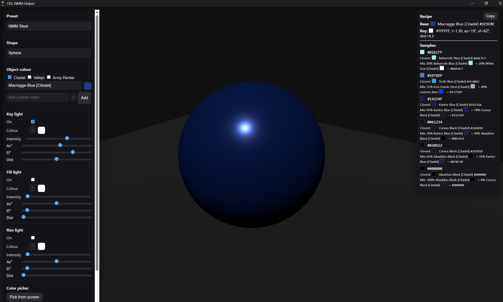
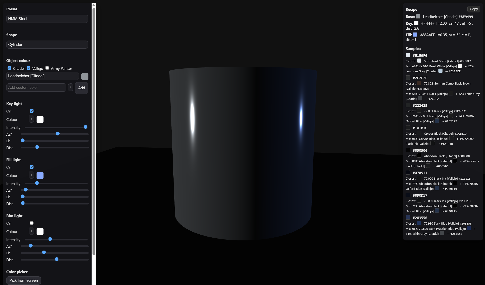
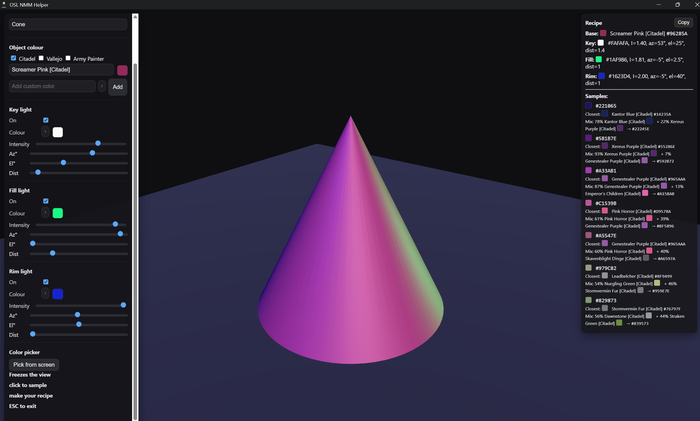

# 🌌 OSL & NMM Helper  

*Turn your desk lamp into a sun, and your paints into magic.*  

Miniature painting is all about light. Getting **Non-Metallic Metal (NMM)** highlights or glowing **Object Source Lighting (OSL)** right can make a model look like it stepped out of a cinematic still — but figuring out how light behaves can be a headache.  

That’s where **OSL & NMM Helper** comes in. This desktop app lets you experiment with light in real time, generate highlight/shadow transitions, and instantly translate them into **paint recipes using Citadel, Vallejo, or Army Painter paints.**  

Think of it as your digital lighting rig and recipe book, built for hobbyists who want pro-level results.  

---

## 🔥 Why you’ll love it  

- 🖼️ **See it before you paint it** – Move lights around your model preview and watch highlights, glows, and shadows react instantly.  
- 🎨 **From pixels to pigments** – Every shade you see comes with a paint recipe you can mix at your desk.  
- 🛠️ **Customizable lighting** – Key, fill, and rim lights with full control over color, angle, and intensity.  
- 🌀 **Practice on different shapes** – Swap between spheres, cones, and more to understand light on surfaces.  
- ⚡ **One-click paint lists** – Copy the full recipe for quick use while painting.  

---

## 👀 See it in action  

| Steel reflections (NMM) | Torchlight glow (OSL) | Multi-colored setup |
|--------------------------|-----------------------|---------------------|
|  |  |  |

---

## 📥 Downloads  

Get the latest release for your system:  

- 🪟 **Windows (.msi)** → [Download](https://github.com/mat2m10/osl_nmm_helper/releases/latest/download/app-windows-x64.msi)  
- 🍎 **macOS (.dmg)** → [Download](https://github.com/mat2m10/osl_nmm_helper/releases/latest/download/app-macos-x64.dmg)  
- 🐧 **Linux (.AppImage)** → [Download](https://github.com/mat2m10/osl_nmm_helper/releases/latest/download/app-linux-x86_64.AppImage)  

---

## ☕ Support  

If this helps your hobby, fuel mine:  
👉 [Buy me a coffee](https://buymeacoffee.com/mat2m10)  

---

## ⚙️ Tech Notes  

- Built with [Tauri](https://tauri.app/) for fast, lightweight desktop apps  
- Built with ❤️ for miniature painters everywhere  